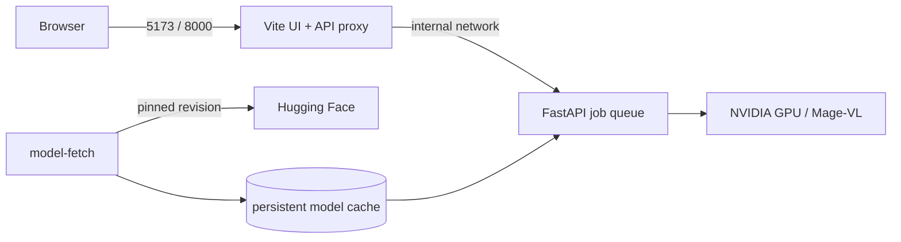

# Mage-VL Studio

[](LICENSE)
[](https://huggingface.co/microsoft/Mage-VL)
[](backend/Dockerfile)
[](frontend/package.json)
[](backend/pyproject.toml)
[](#local-testing)

**A local GPU-powered web demo for the image and video analysis capabilities of Microsoft Mage-VL 4B.**

[日本語ドキュメント](README.md)

> [!IMPORTANT]
> This application is a local demo designed for Windows 11, WSL2, Docker Desktop, and an NVIDIA GPU. It does not provide authentication. Do not expose it to an untrusted network.

## Features

- Image question answering
- Uniformly sampled video-frame analysis
- Traditional H.264 / HEVC codec inference
- Neural codec inference with DCVC-RT
- Streaming inference with a cognition gate and timeline
- Server-Sent Events progress updates
- FIFO single-GPU job queue
- One bounded retry with reduced input after a CUDA OOM
- Browser previews for images and videos
- GPU, dependency, and inference-mode capability diagnostics
- Persisted JSON results with copy and download actions

## Analysis modes

| Mode | Input | Processing path | Suggested 8 GB starting point |
| --- | --- | --- | --- |
| Image | Image | Native-resolution image processor | 98,304 max pixels / 64 tokens |
| Frames | Video | Uniform OpenCV frame sampling | 8 frames / 98,304 pixels / 64 tokens |
| Codec | H.264 / HEVC | Codec-native motion and residual tokens | 4-8 frames / 65,536-98,304 pixels |
| Neural | Video | Checkpoint-bundled DCVC-RT | 4 frames / 65,536 pixels |
| Stream | Video | Segments and cognition gate | 2-8 second segments / up to 12 segments |

`Max Pixels` is automatically rounded down to the closest supported multiple of 16,384.

## Architecture



- Only `model-fetch` has outbound access for downloading the pinned model snapshot.
- The inference backend runs offline on an internal network after the download.
- The backend uses a read-only root filesystem, dropped Linux capabilities, and `no-new-privileges`.
- Browser API traffic passes through the Vite frontend proxy.

## Requirements

- Windows 11
- WSL2
- Docker Desktop using the WSL2 engine
- An NVIDIA driver with WSL2 CUDA support
- An NVIDIA GPU with at least 8 GB VRAM recommended
- Enough disk space for the checkpoint, images, and build cache
- Node.js 24 when running frontend checks directly on the host

## Quick start

### 1. Create the environment file

```powershell
Copy-Item .env.example .env
```

If the default ports are occupied, edit `.env`.

```dotenv
MAGE_API_PORT=18000
MAGE_WEB_PORT=15173
```

### 2. Verify GPU access from Docker

```powershell
docker run --rm --gpus all nvidia/cuda:12.8.0-base-ubuntu22.04 nvidia-smi
```

### 3. Start the application

```powershell
docker compose up -d --build
docker compose logs -f model-fetch
```

An exit code of zero from `model-fetch` is expected. The first run downloads the Mage-VL checkpoint and can require significant time and disk space.

### 4. Open the application

- UI: <http://localhost:5173>
- API proxy: <http://localhost:8000>

Use the configured alternative ports if you changed `.env`.

### 5. Check service health

```powershell
Invoke-RestMethod http://localhost:8000/healthz
Invoke-RestMethod http://localhost:8000/readyz
Invoke-RestMethod http://localhost:8000/api/capabilities |
  ConvertTo-Json -Depth 6
```

## Local testing

### Test strategy

Use four levels of local validation:

1. Static Docker and Compose validation
2. Backend unit and integration tests
3. Frontend component tests, production build, and lint
4. End-to-end smoke testing with the real GPU and model

### 1. Validate Docker configuration

```powershell
docker compose config --quiet
docker compose build
```

Expected results:

- Compose validation exits successfully
- Both backend and frontend images build
- Python distributions are verified against SHA-256 hashes in `backend/requirements.lock.txt`
- npm packages are verified against integrity values in `frontend/package-lock.json`

### 2. Run backend tests

Run 20 tests in the backend image without starting model download or GPU inference.

```powershell
docker compose run --rm --no-deps backend `
  python -m pytest tests -q
```

Coverage includes:

- Upload validation and safe file storage
- Image, frame, traditional codec, and neural codec configuration
- Streaming boundaries and cognition-gate processing
- FIFO queue transitions
- SSE events and persisted results
- Reduced-input OOM retry
- Cancellation of queued and generating jobs
- Pinned Mage-VL model ID and revision

Expected result:

```text
20 passed
```

### 3. Run frontend tests

Install from the lockfile, which is pinned to the public npm registry.

```powershell
npm ci --prefix frontend
npm test --prefix frontend -- --run
npm run build --prefix frontend
npm run lint --prefix frontend
```

Coverage includes:

- Upload and image/video previews
- Blob URL lifecycle under React Strict Mode
- Unsupported-codec preview messaging
- Mode-specific controls
- Conservative Max Pixels normalization
- API request and response normalization
- SSE reconnect and cancellation state
- Streaming timeline rendering

Expected result:

```text
Test Files  5 passed
Tests       11 passed
```

Also verify that `npm run build` and `npm run lint` exit successfully.

### 4. Run the combined checks

If GNU Make is available:

```powershell
make check
```

Otherwise, run the backend and frontend commands above directly.

### 5. Real-model E2E smoke test

#### Start and inspect capabilities

```powershell
docker compose up -d
Invoke-RestMethod http://localhost:8000/api/capabilities |
  ConvertTo-Json -Depth 6
```

Verify that `image`, `video_frames`, `traditional_codec`, `neural_codec`, and `streaming` all report `supported: true`.

#### UI checklist

1. Upload a short H.264 / AAC MP4.
2. Verify the first frame, playback, seek, volume, and fullscreen controls.
3. Select Frames mode and begin with `8 frames / 98304 pixels / 64 tokens`.
4. Select `Run analysis`.
5. Verify Queue → Model → Prepare → Generate → Complete.
6. Inspect the answer, elapsed time, visual tokens, and VRAM metrics.
7. Test JSON download and copy.
8. Start a longer job, cancel it, and verify the transition from `Cancellation requested` to `cancelled`.

#### Submit a job through the API

```powershell
$video = "C:\path\to\short-video.mp4"
$created = curl.exe -sS -X POST http://localhost:8000/api/analyses `
  -F "media=@$video;type=video/mp4" `
  -F "mode=video_frames" `
  -F "question=Describe this video briefly." `
  -F "num_frames=8" `
  -F "max_pixels=98304" `
  -F "max_new_tokens=64" |
  ConvertFrom-Json

do {
  Start-Sleep -Seconds 5
  $job = Invoke-RestMethod "http://localhost:8000/api/analyses/$($created.id)"
  $job | Select-Object status, progress, message
} while ($job.status -notin @("completed", "failed", "cancelled"))

if ($job.status -eq "completed") {
  Invoke-RestMethod "http://localhost:8000/api/analyses/$($created.id)/result" |
    ConvertTo-Json -Depth 8
}
```

#### Monitor the GPU

```powershell
docker exec mage-vl-demoapp-backend-1 `
  nvidia-smi --query-gpu=utilization.gpu,memory.used,memory.total,temperature.gpu `
  --format=csv -l 2
```

In Windows Task Manager, change the graph from `3D` to `CUDA` or `Compute_0`.

### Verified 8 GB profile

All five modes were tested with 4-bit NF4 and FP16 compute on an RTX 3070 Laptop GPU with 8 GB VRAM.

| Mode | Test input | Elapsed | Peak allocated VRAM |
| --- | --- | ---: | ---: |
| Image | 1024x2048 JPEG / 100,000 pixels / 64 tokens | 340.6 s including cold start | 4.05 GB |
| Frames | 4 s H.264 / 4 frames / 16 tokens | 3.5 s | 3.68 GB |
| Codec | 4 s H.264 / 4-frame canvas | 8.6 s | 3.55 GB |
| Neural | 4 s H.264 / 4-frame canvas | 103.3 s | 3.55 GB |
| Stream | 4 s H.264 / two segments | 21.8 s | 4.41 GB |

For long videos, sampled frames, Max Pixels, and Max Tokens have a greater impact on generation cost than the source duration itself. Increase them gradually on an 8 GB GPU.

## Logs and troubleshooting

### Inspect service state

```powershell
docker compose ps -a
docker compose logs --tail 200 backend
docker compose logs --tail 100 frontend
docker compose logs --tail 100 model-fetch
```

### Progress appears stuck at 70%

At 70%, the backend is executing `model.generate()`. Fine-grained percentage updates are not available during token generation.

For a faster run, reduce:

- Sample Frames to 8
- Max Pixels to 65,536 or 98,304
- Max Tokens to 64

### Out of memory

- Close other GPU applications.
- Reduce Sample Frames, Max Pixels, and Max Tokens.
- Inspect Windows system-memory usage as well as VRAM.
- The backend retries once after halving frames and pixels.

### Cancellation is not immediate

The cancellation signal is passed into token-generation stopping criteria. A short delay may occur while the current token step finishes.

### Analysis works but browser preview fails

The backend may decode a file with FFmpeg even when the browser cannot preview it. A broadly compatible format is MP4 with H.264 High/Main, `yuv420p`, and AAC-LC.

Inspect a file with:

```powershell
ffprobe -v error -show_streams -show_format .\video.mp4
```

### Port conflict

Set alternative ports in `.env`.

```dotenv
MAGE_API_PORT=18000
MAGE_WEB_PORT=15173
```

## API reference

| Method | Path | Description |
| --- | --- | --- |
| `POST` | `/api/analyses` | Upload media and create a job |
| `GET` | `/api/analyses/{id}` | Read job state |
| `GET` | `/api/analyses/{id}/events` | Stream SSE progress |
| `GET` | `/api/analyses/{id}/result` | Read a completed result |
| `DELETE` | `/api/analyses/{id}` | Request cancellation |
| `GET` | `/api/capabilities` | Inspect GPU, dependencies, and modes |
| `GET` | `/api/model/status` | Inspect model load state |
| `GET` | `/healthz` | Process health |
| `GET` | `/readyz` | Service readiness |

## Stop and clean up

Stop containers while retaining model and result volumes:

```powershell
docker compose down
```

Delete model weights, uploads, results, and work volumes:

```powershell
docker compose down -v
```

## Security and supply chain

- The model ID is restricted to `microsoft/Mage-VL`.
- Remote code is pinned to revision `d88b153285f1633a61b2f693c59c8576693af185`.
- Because loading uses `trust_remote_code=True`, review the pinned code before execution.
- CUDA and Node base images are digest-pinned.
- Python uses exact versions and SHA-256 hash locking.
- npm uses the public registry and package-lock integrity.
- `.env`, uploads, results, Playwright artifacts, and build caches are excluded from Git.
- Model weights are downloaded to a persistent runtime volume and are not stored in the repository.

## License

This application is released under the MIT License, **Copyright (c) 2026 tokawa-ms**. See [LICENSE](LICENSE).

Microsoft Mage-VL, model weights, remote code, FFmpeg, CUDA, Docker images, and other dependencies remain subject to their respective licenses. See [NOTICE](NOTICE).
