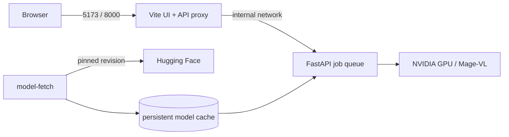

# Mage-VL Studio

[](LICENSE)
[](https://huggingface.co/microsoft/Mage-VL)
[](backend/Dockerfile)
[](frontend/package.json)
[](backend/pyproject.toml)
[](#ローカル環境でのテスト)

**Microsoft Mage-VL 4B の画像・動画解析機能を、ローカルGPUで試せるWebデモです。**

[English documentation](README-en.md)

> [!IMPORTANT]
> このアプリは、Windows 11 + WSL2 + Docker Desktop + NVIDIA GPUを想定したローカルデモです。認証機能はないため、信頼できないネットワークへ公開しないでください。

## 主な機能

- 画像に対する質問応答
- 動画の均等フレームサンプリング解析
- H.264 / HEVCのtraditional codec解析
- DCVC-RTを使用するneural codec解析
- cognition gateを使うstreaming解析とタイムライン表示
- Server-Sent Eventsによる進捗表示
- FIFO方式の単一GPUキュー
- CUDA OOM時の入力縮小・1回限定再試行
- 画像・動画のブラウザプレビュー
- GPU、依存コマンド、各解析モードのcapability診断
- JSON結果の保存、コピー、ダウンロード

## 画面と解析モード

| モード | 入力 | 処理方式 | 8GB GPU向けの開始値 |
| --- | --- | --- | --- |
| Image | 画像 | native-resolution image processor | Max Pixels 98,304 / 64 tokens |
| Frames | 動画 | OpenCVによる均等フレーム抽出 | 8 frames / 98,304 pixels / 64 tokens |
| Codec | H.264 / HEVC | motion/residual tokenを使うcodec-native推論 | 4-8 frames / 65,536-98,304 pixels |
| Neural | 動画 | checkpoint同梱のDCVC-RT | 4 frames / 65,536 pixels |
| Stream | 動画 | segment分割 + cognition gate | 2-8秒 segment / 最大12 segments |

`Max Pixels`はMage-VLが受け付ける16,384刻みの値へ、常に小さい側へ自動補正されます。

## アーキテクチャ



- `model-fetch`だけがモデル取得のため外部ネットワークへ接続します。
- 推論Backendはモデル取得後、offline設定・internal networkで動作します。
- Backendのroot filesystemはread-onlyで、Linux capabilityをdropし、`no-new-privileges`を設定しています。
- BrowserからのAPIアクセスはFrontendのVite proxyを経由します。

## 必要環境

- Windows 11
- WSL2
- Docker Desktop（WSL2 engine）
- WSL2 CUDA対応NVIDIA driver
- NVIDIA GPU、推奨VRAM 8GB以上
- モデル、Docker image、build cache用の十分な空き容量
- Frontendをホスト上でテストする場合はNode.js 24

## クイックスタート

### 1. 設定ファイルを作成

```powershell
Copy-Item .env.example .env
```

既定portが使用中の場合は `.env` を変更します。

```dotenv
MAGE_API_PORT=18000
MAGE_WEB_PORT=15173
```

### 2. DockerからGPUを確認

```powershell
docker run --rm --gpus all nvidia/cuda:12.8.0-base-ubuntu22.04 nvidia-smi
```

### 3. 起動

```powershell
docker compose up -d --build
docker compose logs -f model-fetch
```

`model-fetch`が終了コード0で停止するのは正常です。初回はMage-VL checkpointの取得に時間とディスク容量が必要です。

### 4. ブラウザを開く

- UI: <http://localhost:5173>
- API proxy: <http://localhost:8000>

代替portを設定した場合は、そのportを使用してください。

### 5. 動作状態を確認

```powershell
Invoke-RestMethod http://localhost:8000/healthz
Invoke-RestMethod http://localhost:8000/readyz
Invoke-RestMethod http://localhost:8000/api/capabilities |
  ConvertTo-Json -Depth 6
```

## ローカル環境でのテスト

### テスト方針

ローカル検証は次の4段階で行います。

1. Docker / Compose設定の静的検証
2. Backend unit・integration tests
3. Frontend component tests・build・lint
4. 実GPUと実モデルを使用するE2E smoke test

### 1. Docker設定を検証

```powershell
docker compose config --quiet
docker compose build
```

期待結果:

- Compose validationがエラーなく終了する
- BackendとFrontendのimage buildが成功する
- Python依存は `backend/requirements.lock.txt` のSHA-256 hashで検証される
- npm依存は `frontend/package-lock.json` のintegrityで検証される

### 2. Backend tests

モデルdownloadやGPU推論を開始せず、Docker image内で20件のテストを実行します。

```powershell
docker compose run --rm --no-deps backend `
  python -m pytest tests -q
```

対象:

- upload validationと安全なファイル保存
- 画像・Frames・traditional codec・neural codec設定
- streaming segment boundaryとgate処理
- FIFO job queueと状態遷移
- SSE eventとresult persistence
- OOM縮小再試行
- queued / generating jobのcancel
- Mage-VL model IDとrevision固定

期待結果:

```text
20 passed
```

### 3. Frontend tests

公開npm registryに固定されたlockfileから依存を復元します。

```powershell
npm ci --prefix frontend
npm test --prefix frontend -- --run
npm run build --prefix frontend
npm run lint --prefix frontend
```

対象:

- uploadと画像・動画プレビュー
- React StrictMode下のBlob URL lifecycle
- codec preview error表示
- モード依存control
- Max Pixelsの低負荷側への自動補正
- API request / response normalization
- SSE reconnectとcancel状態
- streaming timeline

期待結果:

```text
Test Files  5 passed
Tests       11 passed
```

`npm run build` と `npm run lint` も終了コード0で完了することを確認してください。

### 4. 一括テスト

GNU Makeが利用できる環境では次を使用できます。

```powershell
make check
```

Makeを使用しない場合は、上記Backend / Frontendコマンドを個別に実行してください。

### 5. 実モデルE2E smoke test

#### 起動とcapability確認

```powershell
docker compose up -d
Invoke-RestMethod http://localhost:8000/api/capabilities |
  ConvertTo-Json -Depth 6
```

`image`、`video_frames`、`traditional_codec`、`neural_codec`、`streaming` がすべて `supported: true` であることを確認します。

#### UIで確認する項目

1. H.264 / AACの短いMP4をアップロードする
2. Previewで先頭frame、再生、seek、音量controlを確認する
3. Frames modeを選び、`8 frames / 98304 pixels / 64 tokens`から開始する
4. `Run analysis`を押す
5. Queue → Model → Prepare → Generate → Completeの順に進むことを確認する
6. 回答、処理時間、visual tokens、VRAMを確認する
7. JSON downloadとcopyを確認する
8. 長めのjobを開始してCancelし、`Cancellation requested`から`cancelled`へ移ることを確認する

#### APIからjobを投入

```powershell
$video = "C:\path\to\short-video.mp4"
$created = curl.exe -sS -X POST http://localhost:8000/api/analyses `
  -F "media=@$video;type=video/mp4" `
  -F "mode=video_frames" `
  -F "question=Describe this video briefly." `
  -F "num_frames=8" `
  -F "max_pixels=98304" `
  -F "max_new_tokens=64" |
  ConvertFrom-Json

do {
  Start-Sleep -Seconds 5
  $job = Invoke-RestMethod "http://localhost:8000/api/analyses/$($created.id)"
  $job | Select-Object status, progress, message
} while ($job.status -notin @("completed", "failed", "cancelled"))

if ($job.status -eq "completed") {
  Invoke-RestMethod "http://localhost:8000/api/analyses/$($created.id)/result" |
    ConvertTo-Json -Depth 8
}
```

#### GPUを監視

```powershell
docker exec mage-vl-demoapp-backend-1 `
  nvidia-smi --query-gpu=utilization.gpu,memory.used,memory.total,temperature.gpu `
  --format=csv -l 2
```

Windows Task Managerでは `3D` ではなく、グラフを `CUDA` または `Compute_0` に変更してください。

### 実測済み8GB GPU profile

RTX 3070 Laptop GPU（8GB）、4-bit NF4、FP16 computeで全5モードを確認しています。

| モード | Test input | 処理時間 | Peak allocated VRAM |
| --- | --- | ---: | ---: |
| Image | 1024x2048 JPEG / 100,000 pixels / 64 tokens | 340.6秒（cold start含む） | 4.05GB |
| Frames | 4秒 H.264 / 4 frames / 16 tokens | 3.5秒 | 3.68GB |
| Codec | 4秒 H.264 / 4-frame canvas | 8.6秒 | 3.55GB |
| Neural | 4秒 H.264 / 4-frame canvas | 103.3秒 | 3.55GB |
| Stream | 4秒 H.264 / 2 segments | 21.8秒 | 4.41GB |

長い動画では動画全体の長さよりも、sample frames、Max Pixels、Max Tokensが生成負荷へ大きく影響します。8GB環境では保守的な値から増やしてください。

## ログとトラブルシューティング

### サービス状態

```powershell
docker compose ps -a
docker compose logs --tail 200 backend
docker compose logs --tail 100 frontend
docker compose logs --tail 100 model-fetch
```

### 70%で止まって見える

70%は `model.generate()` 実行中です。token生成中は細かなpercentを算出できないため、完了まで表示が変わらない場合があります。

GPU使用率とVRAMを確認し、長時間必要な場合は次へ下げてください。

- Sample Frames: 8
- Max Pixels: 65,536または98,304
- Max Tokens: 64

### メモリ不足

- 他のGPUアプリを終了する
- Sample Frames、Max Pixels、Max Tokensを下げる
- Windowsのメインメモリ使用率も確認する
- BackendはOOM時にframesとpixelsを半減して1回だけ再試行する

### Cancelがすぐ完了しない

Cancel要求はtoken生成の停止条件へ渡されます。現在のtoken処理が終わるまで短い遅延が発生する場合があります。

### 動画を解析できるがPreviewできない

Browserが動画codecを再生できない場合でも、BackendのFFmpegが処理できれば解析できます。一般的なpreview形式はMP4、H.264 High/Main、`yuv420p`、AAC-LCです。

確認:

```powershell
ffprobe -v error -show_streams -show_format .\video.mp4
```

### portが使用中

`.env` で変更します。

```dotenv
MAGE_API_PORT=18000
MAGE_WEB_PORT=15173
```

## API reference

| Method | Path | 説明 |
| --- | --- | --- |
| `POST` | `/api/analyses` | uploadと解析job作成 |
| `GET` | `/api/analyses/{id}` | job状態 |
| `GET` | `/api/analyses/{id}/events` | SSE progress |
| `GET` | `/api/analyses/{id}/result` | 完了結果 |
| `DELETE` | `/api/analyses/{id}` | cancel要求 |
| `GET` | `/api/capabilities` | GPU・依存・mode診断 |
| `GET` | `/api/model/status` | model load状態 |
| `GET` | `/healthz` | process health |
| `GET` | `/readyz` | service readiness |

## 停止とデータ削除

コンテナのみ停止し、model cacheと結果を残します。

```powershell
docker compose down
```

model weights、upload、results、work volumeも削除します。

```powershell
docker compose down -v
```

## セキュリティとSupply Chain

- Mage-VL model IDは `microsoft/Mage-VL` に制限
- remote code revisionは `d88b153285f1633a61b2f693c59c8576693af185` に固定
- `trust_remote_code=True` を使用するため、実行前に固定revisionのcodeを確認してください
- CUDA / Node base imageはdigest固定
- Pythonはexact version + SHA-256 hash lock
- npmは公開registry + package-lock integrity
- `.env`、upload、results、Playwright artifacts、build cacheはGit対象外
- model weightsはrepositoryへ含めず、runtimeにpersistent volumeへ取得

## ライセンス

このアプリケーションは **Copyright (c) 2026 tokawa-ms** のMIT Licenseで公開されます。詳細は [LICENSE](LICENSE) を参照してください。

Microsoft Mage-VL、model weights、remote code、FFmpeg、CUDA、Docker image、その他依存componentにはそれぞれのライセンスが適用されます。詳細は [NOTICE](NOTICE) を参照してください。
